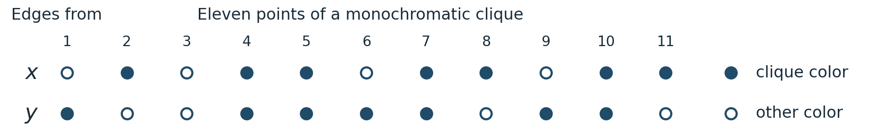

**Abstract.** Erdős and Gyárfás asked whether every $r$-coloring of the edges of $K_{r^2+1}$ contains $r+1$ vertices that miss a color. We prove their conjecture for every $r\ge 2^{144}$ and, by a different argument, for $r=12$. Together with the fixed cases through eleven, this leaves only $13\le r<2^{144}$ as possible exceptions. At large orders the proof extracts monochromatic cliques in a sparsest color and bounds the cost of choosing representatives from them. At twelve colors, six exterior vertices would each need a different row, and only five rows are available.

## The affine-plane construction

The conjecture has a sharp boundary for infinitely many $r$. Take the $r^2$ points of an affine plane of prime-power order $r$. Color each pair by the direction of the line joining it, then merge two of the $r+1$ direction colors. Every set of $r+1$ points still sees every color. Indeed, in each direction the plane splits into $r$ parallel lines, so two of the chosen points lie on the same line. Erdős and Gyárfás conjectured that on adding just one point, **every** coloring must lose this property. They proved the cases $r=3,4$. [Original paper, Conjecture 1 and Lemmas 1–2](https://www.renyi.hu/~gyarfas/Cikkek/92_splitandbalanced.pdf)

**Theorem A.** Let $r$ be an integer with $r\ge 2^{144}$. For every coloring of the edges of $K_{r^2+1}$ with $r$ colors there is a set of $r+1$ vertices and a color that occurs on none of its edges.

Suppose every $r+1$ vertices see all colors. A color with the fewest edges must then be sparse enough that a stability theorem places most of its edges inside rows. We extract large cliques in that color. An independent choice across these cliques gives one representative per row. To reach $r+1$, we also need outside vertices, whose neighbors may block some choices. The proof tracks the actual edges a blocked choice costs. The improvement to $2^{144}$ comes from charging deleted vertices and discarded rows to the *same* budget. Across five ranges of the parameters, one scale always leaves enough room to derive a contradiction. The width calculation and its earlier combinatorial inputs appear below.

**Theorem B.** In every twelve-coloring of the edges of $K_{145}$, some thirteen vertices miss a color.

Here the difficult case has 61 vertices and a budget of 408 edges of the chosen color. In the last possible configuration there are five cliques of eleven vertices each. Each of the six vertices outside them must join all but at most four points of some clique in the chosen color. Two of the six must use the same clique. On those thirteen vertices at most $4+4+1=9$ edges are available for the eleven other colors. This raises the 61-vertex edge floor to 409. Two further bounds, on 47 and 59 vertices, exclude the other possible stops in the reduction.

<!-- pagebreak -->

## Fixed cases and verification

| Colors | Work and public record |
|------------|-----------------------------------------------------------------------|
| $3,4$ | Erdős and Gyárfás proved both cases in their 1999 paper. [Original paper](https://www.renyi.hu/~gyarfas/Cikkek/92_splitandbalanced.pdf) |
| $5,6,7,8,9$ | Robert Sneiderman released the proofs for five through eight on 20 July 2026 and for nine on 21 July. The proofs at five and six are graph-theoretic. The others use finite certificates. [Five through eight](https://github.com/Robby955/erdos-617-fixed-cases/releases/tag/fixed-r5-r8-2026-07-20) · [Nine](https://github.com/Robby955/erdos-617-fixed-cases/releases/tag/fixed-r9-2026-07-21) |
| $10,11$ | Terpstra Research publicly released computer-assisted proofs in August 2026. This project later obtained separate arguments for both orders. [August release](https://github.com/terpstra-research/erdos-617-r10-r11/releases/tag/v0.1.1) · [Ten, Theorem 21](proof/overfull-core.md#12-order-ten) · [Eleven](proof/midpoint-row-excess.md) |
| $12$ | Theorem B in this manuscript. The local edge bounds and the final reduction have two separately written integer replays. [Lower-bound calculation](proof/verify_order_twelve.py) · [Capacity calculation](proof/replay_order_twelve.py) |

Sneiderman publicly posted his five-color proof claim on 18 July. Ramazan Kara credits that proof as the mathematical basis of his Lean and certificate verification. Conner Silverstein and Anthony Rose gave separate computer-assisted arguments, as did Hai Xia and Stefan Szeider in October. [July 18 claim](https://www.erdosproblems.com/forum/thread/617/proof-claims#proof-claim-83) · [Kara's verification](https://github.com/RamazanKara/erdos-617-r5-formal-verification) · [Silverstein](https://github.com/Sprite143/erdos617-r5-computer-proof) · [Rose](https://github.com/arose-logos/erdos-gyarfas-r5/blob/main/paper/erdos617_paper.md) · [Xia and Szeider](https://arxiv.org/abs/2610.24484)

**What Lean checks.** For Theorem A, Lean proves that every feasible pair of real pruning parameters belongs to one of the five bands where the width comparison succeeds. Its uniform lower bound on the margin is $7/10000$. For Theorem B, Lean constructs a thirteen-element set and a missing color from the eleven-point clique and its two exterior vertices. Deriving those configurations from an arbitrary coloring uses the written proofs and the accompanying exact calculations. Both complete arguments await independent mathematical review. [Width comparison](proof/RetainedWidth.lean) · [Thirteen-vertex witness](proof/OrderTwelveCollision.lean)

**Contributions.** Robert Sneiderman directed the research and handles correspondence. OpenAI GPT-6.2 Astra, the AI model used in Codex, contributed to proof search, calculations, Lean proofs and drafting. Fable contributed fixed-row arguments and checked earlier steps. The July releases document the tools used for those earlier results. [July disclosure](https://github.com/Robby955/erdos-617-fixed-cases/blob/fb628c8cf5ea7173c245c9542b69d72c11cce4a4/AI_DISCLOSURE.md)

**Guide to the proof.** The next two chapters give the cutoff improvement and the twelve-color argument. The appendices give the earlier large-order estimates they cite, ending with the underlying stability and sampling arguments. The separate row lemmas and their finite certificates accompany the twelve-color proof. [Row lemmas](proof/overfull-core.md#6-a-reduction-to-local-statements-for-any-hue) · [Four-row certificates](proof/four-row-descent.md)

**Sources for the large-order argument.** P. Erdős and A. Gyárfás, “Split and balanced colorings of complete graphs,” *Discrete Mathematics* **200** (1999), 79–86. Z. Füredi gives the stability partition used for the sparsest color. A. Graf, D. G. Harris and P. Haxell give the weighted independent transversal theorem used to choose representatives from the rows. [Erdős and Gyárfás](https://www.renyi.hu/~gyarfas/Cikkek/92_splitandbalanced.pdf) · [Füredi, Theorem 1](https://arxiv.org/abs/1501.03129) · [Graf, Harris and Haxell, Theorem 7](https://arxiv.org/abs/1907.00033)
