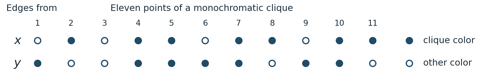

**Abstract.** Every $r$-coloring of the edges of $K_{r^2+1}$ contains $r+1$ vertices missing a color whenever $r\ge 255\cdot 2^{136}$. We prove this by counting the edges that can prevent an independent choice across monochromatic cliques. Lean verifies the result from the original coloring. A separate proof at $r=12$, together with the fixed cases through eleven, leaves only $13\le r<255\cdot 2^{136}$ as possible exceptions.

## The affine-plane construction

Call a coloring *balanced* if every set of $r+1$ vertices spans an edge of each color. For a prime power $r\ge3$, take the $r^2$ points of an affine plane of order $r$. Color each edge by the direction of its line, then merge two of the $r+1$ direction classes. For each direction, the $r$ parallel lines partition the plane, so two of any $r+1$ points determine that direction. The coloring is therefore balanced. Erdős and Gyárfás conjectured that no balanced $r$-coloring exists on $r^2+1$ vertices for any $r\ge3$. They proved this for $r=3,4$. [Original paper, Conjecture 1 and Lemmas 1–2](https://www.renyi.hu/~gyarfas/Cikkek/92_splitandbalanced.pdf)

**Theorem A.** Let $r$ be an integer with $r\ge 2^{144}$. For every coloring of the edges of $K_{r^2+1}$ with $r$ colors there is a set of $r+1$ vertices and a color that occurs on none of its edges.

Suppose the coloring is balanced and fix a color with the fewest edges. A stability theorem gives a partition in which most edges of that color lie within parts. We extract monochromatic cliques from the parts. To obtain $r+1$ vertices missing the chosen color, we seek one representative from each retained clique and additional vertices outside them. The edges between the cliques and the exterior constrain these choices. Counting the edges incident to deleted vertices also bounds how many parts can be discarded. In each of five parameter ranges, these bounds contradict balance. Appendix I gives the sharper cutoff $255\cdot 2^{136}$. [Proof of the sharper bound](#formal-proof)

**Theorem B.** In every twelve-coloring of the edges of $K_{145}$, some thirteen vertices miss a color.

At twelve colors the reduction gives a 61-vertex set spanning at most 408 edges of the chosen color. Under that bound, five disjoint eleven-vertex cliques remain. Each of the six exterior vertices has at least seven neighbors in some clique in the chosen color. Two exterior vertices must use the same clique. Among those thirteen vertices at most $4+4+1=9$ edges can carry the eleven other colors, contradicting balance. This proves the lower bound of 409. Bounds on 47- and 59-vertex sets exclude the remaining cases.

<!-- pagebreak -->

## Fixed cases and verification

| Colors | Previous results |
|------------|-----------------------------------------------------------------------|
| $3,4$ | Erdős and Gyárfás proved both cases in their 1999 paper. [Original paper](https://www.renyi.hu/~gyarfas/Cikkek/92_splitandbalanced.pdf) |
| $5,6,7,8,9$ | Robert Sneiderman released the proofs for five through eight on 20 July 2026 and for nine on 21 July. The proofs at five and six are graph-theoretic. The others use finite certificates. [Five through eight](https://github.com/Robby955/erdos-617-fixed-cases/releases/tag/fixed-r5-r8-2026-07-20) · [Nine](https://github.com/Robby955/erdos-617-fixed-cases/releases/tag/fixed-r9-2026-07-21) |
| $10,11$ | Adam Lee Terpstra directed the computer-assisted proofs produced with OpenAI Codex and released on 11 August 2026. We later obtained separate arguments. [August release](https://github.com/terpstra-research/erdos-617-r10-r11/releases/tag/v0.1.0) · [Ten, Theorem 21](proof/overfull-core.md#12-order-ten) · [Eleven](proof/midpoint-row-excess.md) |
| $12$ | Theorem B in this manuscript. The local edge bounds and the final reduction have two independent integer calculations. [Lower-bound calculation](proof/verify_order_twelve.py) · [Capacity calculation](proof/replay_order_twelve.py) |

Nick Winter’s five-color Lean release is dated 13 July. Sneiderman posted his five- and six-color manuscripts on 18 July. Ramazan Kara based his five-color verification on Sneiderman’s proof. Winter’s six-color Lean proof credits Sneiderman’s argument for its route and intermediate results. [Winter, five colors](https://github.com/nwinter/erdos-617-r5/releases/tag/v1.1-public) · [July manuscripts](https://github.com/Robby955/erdos-617-fixed-cases/commit/c19ce7e) · [Kara](https://github.com/RamazanKara/erdos-617-r5-formal-verification) · [Winter, six colors](https://github.com/nwinter/erdos-617-r5/blob/32f1bfe6759299ef3a1c6e8b4c3c637528a9881b/reviews/sneiderman-r6.md#L620-L641)

Conner Silverstein and Anthony Rose also gave computational proofs at five colors in July. Hai Xia and Stefan Szeider submitted a separate five-color proof to arXiv on 17 October. [Silverstein](https://github.com/Sprite143/erdos617-r5-computer-proof) · [Rose](https://github.com/arose-logos/erdos-gyarfas-r5/blob/main/paper/erdos617_paper.md) · [Xia and Szeider](https://arxiv.org/html/2610.24484v1)

**Formal verification.** Given any coloring at $r\ge 255\cdot2^{136}$, Lean proves that a set of $r+1$ vertices misses a color. Three kernels accepted the same proof export. At twelve colors, Lean verifies the final thirteen-vertex witness. The written argument and two integer calculations establish the hypotheses for that witness. Independent mathematical review is pending. [Cutoff proof and replay](proof/formal-cutoff.md) · [Twelve-color witness](proof/OrderTwelveCollision.lean)

**Contributions.** Robert Sneiderman directed the research and handles correspondence. OpenAI GPT-6.2 Astra, the AI model used in Codex, contributed to proof search, calculations, Lean proofs and drafting. Fable contributed fixed-row arguments and checked earlier steps. The July releases document the tools used for those earlier results. [July disclosure](https://github.com/Robby955/erdos-617-fixed-cases/blob/fb628c8cf5ea7173c245c9542b69d72c11cce4a4/AI_DISCLOSURE.md)

The twelve-color proof uses the [two- and three-row bounds](proof/overfull-core.md#6-a-reduction-to-local-statements-for-any-hue) and the [four-row certificates](proof/four-row-descent.md).

**References.** P. Erdős and A. Gyárfás, “Split and balanced colorings of complete graphs,” *Discrete Mathematics* **200** (1999), 79–86. Z. Füredi gives the stability partition used for the sparsest color. A. Graf, D. G. Harris and P. Haxell give the weighted independent transversal theorem used to choose representatives from the rows. [Erdős and Gyárfás](https://www.renyi.hu/~gyarfas/Cikkek/92_splitandbalanced.pdf) · [Füredi, Theorem 1](https://arxiv.org/abs/1501.03129) · [Graf, Harris and Haxell, Theorem 7](https://arxiv.org/abs/1907.00033)
